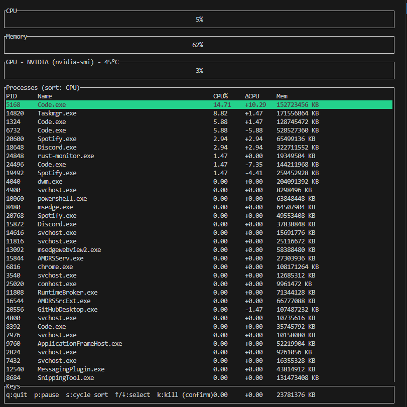

# rust-monitor

Minimal Rust TUI system monitor using `ratatui` and `sysinfo`. It shows CPU, memory and GPU gauges above a sortable process table, and can kill the selected process.



## Quick start

Prerequisites:

- Rust toolchain (stable)

Build:

```sh
cargo build --release
```

Run:

```sh
cargo run --release
```

Show only processes whose name contains `myprocess`:

```sh
cargo run --release -- -n myprocess
```

CLI flags:

| Flag | Effect |
| --- | --- |
| `-n, --process <NAME>` | filter processes by name (case-insensitive substring) |
| `-p, --pid <PID>` | show only the given PID |
| `-i, --interval <MS>` | refresh interval in milliseconds (default: 1000) |

Keys:

| Key | Action |
| --- | --- |
| `q` | quit |
| `p` | pause or resume refreshing |
| `s` | cycle the sort column: CPU, ΔCPU, Mem, Name, PID |
| Up / Down | move the selection |
| `k` | ask to kill the selected process, then `y` to confirm or `n` to cancel |

## GPU support

- Optional NVIDIA NVML support: `cargo run --features nvml --release`. This reads utilization and temperature for the first GPU.
- Without the `nvml` feature the app runs `nvidia-smi` on every refresh. On Windows, if that fails, it falls back to PowerShell performance counters, which report utilization but no temperature.
- If neither source returns a reading, the gauge shows `GPU: N/A`.

## Code layout

- `src/main.rs`: argument parsing, the refresh and input loop, sorting
- `src/metrics.rs`: `sysinfo` wrapper for CPU, memory and the process list
- `src/gpu.rs`: NVML query and the `nvidia-smi` / PowerShell fallback
- `src/ui.rs`: `ratatui` layout and widgets

## Testing

`cargo test` runs three unit tests for the GPU output parsing helpers. CI in `.github/workflows/ci.yml` runs `cargo fmt --check`, `cargo clippy`, `cargo build` and `cargo test` on Ubuntu and Windows.

## Limitations

- The loop sleeps for the refresh interval between input polls, so a key press can take up to one interval to register.
- The process table does not scroll. Rows beyond the height of the terminal are not visible, even when selected.
- The Mem column prints the byte count from `sysinfo` with a `KB` label.
- The terminal is restored on a normal quit with `q`, but not if the program exits with an error.
